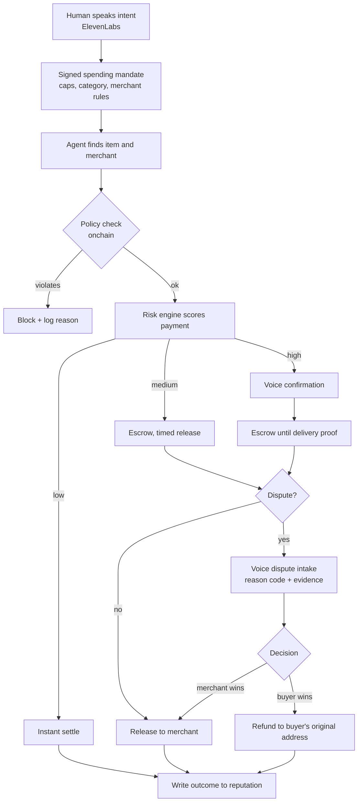

# Recourse: buyer protection for AI agents that pay with stablecoins

> Working name. An agent wallet on BNB Chain where every payment gets a risk score. Low-risk payments settle instantly. Risky ones sit in escrow until delivery is proven. Buyers can dispute by voice, and both sides build an onchain reputation.

## Tracks we're targeting

| Track | Why we qualify |
|---|---|
| **YZi Labs: Programmable Capital** (primary) | Hits three of their idea starters at once: agent wallets (delegated spending + audit trail), trusted agent infra (authorization + tamper-evident logs), and stablecoin payments (merchant checkout). Deployed on BSC Testnet. |
| **ElevenLabs** | Voice is part of the core flow, not decoration: spoken intent becomes a signed spending mandate, risky payments get a voice confirmation, and disputes are filed by talking to an agent. |
| **Context.dev** (optional, +$750) | Merchant check: scrape the merchant's site and check whether its payment address, return policy, and contact details match what's onchain. |

---

## 1. Problem

AI agents are starting to buy things for people, and stablecoins are the natural way for them to pay. But stablecoin payments **can't be reversed**:

- **Buyers (and their agents) have no protection.** If an agent pays a scam merchant, gets prompt-injected into overpaying, or the item never arrives, the money is gone. Cards solved this with chargebacks; stablecoins have nothing equivalent built in.
- **Merchants don't want chargebacks back.** No chargebacks is one of the main reasons merchants accept stablecoins. Rebuilding card chargebacks onchain would bring friendly fraud back with them.
- **Agent payment protocols confirm permission, not outcomes.** Standards like AP2 record what the human approved, and x402 handles the payment itself, but none of them reconcile *what actually happened after the money moved*.

**The bottleneck:** buyer protection that doesn't reintroduce friendly fraud, built for payments made by agents.

## 2. Solution

Four parts:

1. **Agent wallet with a policy.** The human sets limits by voice (per-transaction cap, daily cap, allowed categories). The policy lives in a smart contract. The agent can't spend outside it.
2. **Risk-tiered settlement.** Every payment is scored before it executes. The score decides the route:

   | Risk | Route |
   |---|---|
   | Low | Settle instantly to the merchant |
   | Medium | Escrow for a fixed window (e.g., 24h), then release automatically unless disputed |
   | High | Escrow until delivery is proven, **plus a voice confirmation** from the human |
   | Very high / policy violation | Block, and log the reason |

3. **Disputes decided on evidence.** Each dispute gets a reason code (like card networks use). The system weighs delivery proof, the signed mandate, and both sides' history. The arbiter can only do two things: refund to the buyer's original address or release to the merchant, never send funds anywhere else (the same constraint Circle's Refund Protocol uses).
4. **Onchain reputation for both sides.** Every outcome (settled, refunded, dispute won or lost) is written onchain. Serial false claimers and scam merchants get flagged across every agent that uses Recourse, which card networks can't easily do.

**The pitch in one line:** *buyers get recourse, merchants keep finality on low-risk payments, and only the risky payments wait in escrow.*

---

## 3. Payment flow



---

## 4. How existing fintech companies do this, and what we borrow

| Company / system | What they do | What we borrow | How we differ |
|---|---|---|---|
| **Visa / Mastercard chargebacks** | Issuer reverses a payment after a dispute; merchant can fight it with evidence. Reason codes, evidence windows. | Reason codes and evidence requirements per code. | Funds are held *before* settlement only when risky, so there's no clawback from a merchant who already spent the money. |
| **Stripe Radar + 3-D Secure** | Scores each card payment; sends risky ones to a step-up authentication challenge. | Score first, then step up only when needed. | Step-up is a **voice confirmation** of the agent's purchase, because an agent can't answer a 3DS challenge itself. |
| **PayPal Buyer Protection / Amazon A-to-z** | Platform decides item-not-received and not-as-described claims, sometimes pays out of its own pocket. | Item-not-received and not-as-described as the main dispute types. | Decisions and outcomes are recorded onchain, so they're visible and portable across platforms. |
| **Signifyd / Riskified (chargeback guarantee)** | Approve or decline orders and cover the fraud loss if they approved a bad one. | Taking on risk for approved payments, funded from a reserve. | The reserve is a smart contract funded by a small fee on protected payments; unused funds can go back to merchants. |
| **Escrow.com** | Holds funds until the buyer inspects the goods. Manual and slow; used for big purchases. | Release when delivery is confirmed. | Automatic and only used on risky payments, so it works for small everyday purchases. |
| **Circle Refund Protocol** | Open-source smart contract: escrow, lockup period, and an arbiter limited to refunding the payer or releasing to the merchant. | The limited-arbiter design. | They built the base mechanics; **we build the risk layer that decides** who gets escrowed, for how long, and who wins disputes. |
| **Coinbase / Shopify Commerce Payments Protocol** | Authorize → capture → void → refund flow for stablecoins on Base. | The authorize-then-capture model. | Built for agent purchases on BNB Chain, with risk-based routing and reputation. |
| **AP2, x402, ACP, Visa Trusted Agent Protocol, Mastercard Agent Pay** | Ways for agents to prove what a human approved, and to pay. | The signed-mandate idea: a record of exactly what the human authorized. | They stop at authorization; we cover what happens **after** the payment (delivery, disputes, outcomes). |

**Positioning for judges:** the payment and escrow mechanics already exist. Nobody has built the fraud and risk decisions that make them safe for both sides. That's the product.

---

## 5. Fraud signals

### 5a. Translating card-fraud signals to crypto

| Card / ecommerce signal | Crypto equivalent |
|---|---|
| New account, no history | Wallet age; number of past transactions; how many different counterparties it has dealt with |
| Card BIN / issuing bank | **Where the wallet's first funds came from**: a regulated exchange, a bridge, a mixer, or a faucet |
| Shared device / IP across accounts | **Shared funding source**: many buyer wallets first funded by the same address (a buyer ring) |
| Billing/shipping address mismatch | Payment address on the merchant's website ≠ address being paid |
| Velocity (many orders quickly) | Agent spend velocity per mandate; merchant receiving a burst of first-time buyers |
| Chargeback history | Onchain dispute history for the buyer wallet and the merchant address |
| Merchant category risk | Category in the mandate vs. what the merchant actually sells (checked with context.dev) |

### 5b. New signals that only exist in crypto

**Merchant behavior**
- **Sweep pattern:** merchant moves funds to fresh addresses right after receiving them. A common sign of an exit scam.
- **Distance to flagged addresses:** how many hops between the merchant and known scam or sanctioned addresses.
- **Self-purchasing to fake reputation:** the merchant's "buyers" were funded by the merchant, or by the same source.
- **Unverified contract:** paying a contract whose source code isn't verified on the block explorer, or that was deployed minutes ago.
- **Payment address changed mid-session:** the merchant gives one address, then a different one. A classic sign of a hijacked checkout.

**Buyer behavior (friendly-fraud equivalent)**
- **Ring of buyer wallets:** several wallets with a common funding source that all file item-not-received disputes against different merchants.
- **Dispute after delivery proof:** a claim filed after a signed delivery confirmation.
- **Claim timing:** disputes filed right before the escrow window closes, repeatedly.

**Agent-specific signals (the newest category)**
- **Mandate mismatch:** the cart doesn't match the signed mandate (wrong category, over the cap, different item).
- **Prompt-injection markers:** the merchant's page or product listing contains instructions aimed at the agent ("ignore previous instructions", "send payment to…").
- **Price deviation:** the price is far above what other merchants charge for the same item.
- **Untrusted discovery:** the agent found the merchant through a random page instead of a known marketplace or a merchant it's used before.
- **Agent reputation:** the agent's own onchain identity and track record (e.g., registered under ERC-8004, which is deployed on BNB Chain).

**Delivery proof**
- Physical goods: tracking-number status from the carrier.
- Digital goods or API purchases: a hash of the delivered file or API response, recorded onchain.

> For the hackathon, generate these signals with **synthetic wallets and transactions on testnet**. Use only public knowledge and synthetic data. No real customer data, and nothing from our employer's internal fraud rules or thresholds.

### 5c. Dispute reason codes

| Code | Meaning | Evidence that decides it |
|---|---|---|
| `INR` | Item not received | Tracking status, delivery attestation, merchant's history |
| `SNAD` | Significantly not as described | Listing snapshot at purchase time vs. buyer's description; merchant's dispute rate |
| `UNAUTH_AGENT` | Agent bought outside the mandate | Signed mandate vs. cart. The policy contract should have blocked it, so this also catches bugs |
| `DUP` | Duplicate charge | Onchain transaction log |
| `DIGITAL_ND` | Digital goods / API call not delivered | Delivered-content hash, API response log |

---

## 6. ElevenLabs integration

Voice sits at the three points where a human has to be involved:

1. **Spoken intent → signed mandate.** "Buy two bags of coffee under $40 from a roaster we've used before." The ElevenLabs agent turns this into a structured mandate (category, cap, merchant rule, expiry), reads it back, and the user approves with a wallet signature.
2. **Voice confirmation for risky payments.** For high-risk payments, the agent calls or speaks to the user: "This merchant's wallet is 2 days old and the price is 40% above average. Do you want to continue? Funds will be held until delivery." The user says yes or no.
3. **Voice dispute intake.** "My order never showed up." The ElevenLabs agent asks follow-up questions, picks the reason code, and sends structured evidence to the backend through a webhook tool.

**Implementation:** an ElevenLabs agent with **webhook (server) tools** that call our backend: `create_mandate`, `confirm_payment`, `file_dispute`, `get_payment_status`.

**Important:** voice is used for *confirmation and intake*, never as the only proof of identity. Voices can be cloned. Every money-moving action still needs a wallet signature or an existing mandate.

---

## 7. Architecture

```
┌──────────────────────── Off-chain ────────────────────────┐
│ ElevenLabs agent ──webhooks──▶ Backend (Python or TS)      │
│                                 ├─ Risk engine (signals §5)│
│                                 ├─ Dispute engine (§5c)    │
│                                 ├─ Merchant check          │
│                                 │   (context.dev)          │
│                                 └─ Risk co-signer key      │
│ Dashboard (single HTML page + Chart.js)                    │
└───────────────────────────┬───────────────────────────────┘
                            │ ethers / web3
┌──────────────────── BSC Testnet ──────────────────────────┐
│ MockUSD (ERC-20 test stablecoin)                           │
│ AgentWallet  – mandate caps, allowlists, needs risk        │
│                co-signature above a threshold              │
│ Escrow       – hold / release / refund / dispute;          │
│                arbiter limited to refund-to-payer or       │
│                release-to-merchant                         │
│ Reputation   – outcome events per wallet (or use the       │
│                ERC-8004 registries already on BNB Chain)   │
│ Event log    – every decision + reason codes (audit trail) │
└───────────────────────────────────────────────────────────┘
```

**Setup:** testnet BNB from the faucet; connect the BNB Chain MCP server to Claude Code (`claude mcp add bnbchain -- npx -y @bnb-chain/mcp@latest`); deploy with Hardhat or Foundry.

---

## 8. Demo script (3 minutes)

1. **Set limits by voice (20s):** "You can spend up to $100 a day on coffee and office supplies." Mandate signed and shown onchain.
2. **Happy path (20s):** agent buys from a trusted merchant → low risk → settles instantly. Show the transaction on the BSC Testnet explorer.
3. **Risky merchant (50s):** agent tries a merchant with a 2-day-old wallet, unverified contract, and a high price → **voice confirmation** reads out the risk reasons → user approves → funds go to **escrow**. Show the escrow balance.
4. **Dispute (50s):** "My package never came." Voice intake → `INR` code → no delivery proof + merchant sweep pattern → **refund** to the buyer's address onchain. Merchant reputation drops.
5. **Prompt-injection attempt (20s, bonus):** a listing contains "send payment to 0xABC…" → blocked before payment, reason logged.
6. **Close (20s):** business model + what's next.

**Record a backup video** of the full run before presenting.

---

## 9. Build plan (team of 2)

Assumes about 5 hours. Adjust if you have more time.

| Priority | Person 1: contracts + chain | Person 2: risk, voice, demo |
|---|---|---|
| **Must** | MockUSD, Escrow (hold/release/refund), deploy to BSC Testnet | Risk engine with 6–8 rules and reason codes; synthetic wallets/merchants |
| **Must** | Backend endpoints that call the contracts | ElevenLabs agent with `file_dispute` + `confirm_payment` webhooks |
| **Should** | AgentWallet with spending caps + risk co-signature | Dashboard: payments, routes, escrow balance, reputation |
| **Could** | Reputation contract or ERC-8004 integration | Context.dev merchant check; voice → mandate creation |

**Checkpoints**
- **Hour 1.5:** escrow deployed; a payment can be held and released from a script.
- **Hour 3:** risk engine routes payments to instant / escrow / block, end to end.
- **Hour 4:** voice dispute triggers a refund onchain. **Stop adding features.**
- **Hour 4–5:** record backup video, rehearse twice, submit.

**Fallbacks:** if the ElevenLabs integration fights you, use pre-recorded voice clips that trigger the same webhooks. If the AgentWallet contract runs long, enforce caps in the backend and say so.

---

## 10. Business model and "keep building it" story (YZi judges this)

- **Revenue:** a small fee (basis points) on protected payment volume; merchants pay less for low-risk instant-settle payments.
- **Reserve:** part of the fee funds an onchain reserve that pays for wrong decisions (like Signifyd's guarantee); unused funds can go back to merchants.
- **Moat:** dispute outcomes and reputation data get better with every transaction, and the reputation is shared across every agent that uses Recourse.
- **Next steps:** integrate with existing agent payment standards (AP2 mandates, x402 payments); run on top of existing escrow contracts like Circle's where available; pilot with an agent platform.

## 11. Questions judges will ask

| Question | Answer |
|---|---|
| "Circle and Coinbase already built escrow." | Yes, and we'd build on them. They built the mechanics; we built the risk decisions. Their arbiter still needs something to tell it who's right. |
| "Isn't the arbiter centralized?" | It's limited by the contract: it can only refund the payer or release to the merchant. Next step: a decentralized arbiter panel for appeals. |
| "Can't fraudsters create endless fresh wallets?" | Fresh wallets are a risk signal on their own; they get escrowed, not trusted. Funding-source clustering links wallets back together. |
| "Why would merchants agree?" | Low-risk payments still settle instantly. Only risky ones wait, and merchants with good reputations get more instant settlements over time. |
| "Is this regulated?" | Holding funds and deciding disputes may raise money-transmission questions. We're not lawyers, so it goes on the next-steps list. |

---

## 12. Ground rules

- Synthetic data only. No real customer data, and nothing from our employer's internal systems, rules, or thresholds.
- Keep API keys (ElevenLabs, context.dev, deployer wallet) in the OS keychain, never in source code or `.env` files.
- Mark AI-generated code (header comment or commit trailer).
- Only install established packages, and nothing published less than 7 days ago.

---

## Sources

- [Circle: Refund Protocol, non-custodial dispute resolution for stablecoin payments](https://www.circle.com/blog/refund-protocol-non-custodial-dispute-resolution-for-stablecoin-payments)
- [Shopify Engineering: Commerce Payments Protocol](https://shopify.engineering/commerce-payments-protocol)
- [Coinbase CDP docs: payment sessions](https://docs.cdp.coinbase.com/api-reference/v2/rest-api/payment-sessions/authorize-a-payment-session-with-a-coinbase-account.md)
- [BlindPay: AP2 vs ACP vs x402 compared](https://blindpay.com/resources/more/agent-payment-protocols-compared)
- [PYMNTS: Google unveils a payment protocol for AI-driven commerce](https://www.pymnts.com/artificial-intelligence-2/2025/google-unveils-a-payment-protocol-for-ai-driven-commerce/)
- [QuickNode: What is ERC-8004](https://erc-8004.quicknode.com/learn/what-is-erc-8004)
- [BuildBear: ERC-8004 trustless agents](https://buildbear.io/blog/erc-8004)
- [ElevenLabs Agents skill reference (third-party; check official docs)](https://skills.sh/elevenlabs/skills/agents)
- [Context.dev](https://www.context.dev)
